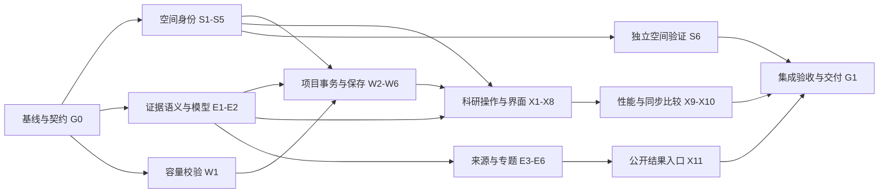

# NeuroAtlas 科研可信度与用户体验 Implementation Plan

> **For agentic workers:** REQUIRED SUB-SKILL: Use superpowers:subagent-driven-development (recommended) or superpowers:executing-plans to implement this plan task-by-task. Steps use checkbox (`- [ ]`) syntax for tracking.

**Goal:** 完整落实两轮审查提出的修正，把脑区身份、空间定位、论文结果、原文依据和研究现场恢复连成可靠且易用的科研流程。

**Architecture:** 四条工作流共用身份、证据和项目契约；独立模块可以并行开发，共用组件由一个集成负责人按依赖顺序接入。先修可信度与数据保存，再打通科研操作、改善布局与性能，最后扩充有来源的证据和独立验收；不一次性重写整个网站。

**Tech Stack:** 现有 React 19、Three.js、Vite、Node、浏览器本地存储与 Worker；Node 单元/回归测试及隔离环境的浏览器测试。科学资产处理遵守 conda 环境要求。

**Spec:** [00-spec.md](00-spec.md)。

日期：**2026-10-29**。计划编制已完成；用户随后授权持续执行，当前状态见 [执行进度](EXECUTION.md)。下文的“本轮规划”指最初编制阶段，实际实施依据最新用户授权和执行台账推进。

## 从这里开始阅读

| 文件 | 用途 |
|---|---|
| [总规格与共同约束](00-spec.md) | 目标、范围、原始资料保护、唯一实施目录、接口与验证边界 |
| [50 项完整问题台账](backlog.csv) | 每个发现的编号、证据类型、优先级、任务归属和验收；当前均为未开始 |
| [01 空间与图谱](01-spatial.md) | S1–S6：真实标签身份、查询一致性、ROI 网格、来源清单、独立 QC |
| [02 项目与资产](02-workspace.md) | W1–W6：原子导入、项目隔离、统一校验、资产管理、图层及复现保存 |
| [03 文献与证据](03-evidence.md) | E1–E6：关系语义、结构化结果、检索、原文材料、独立证据包与专题案例 |
| [04 交互与视觉](04-experience.md) | X1–X11：坐标、选择/比较、阅读布局、图层、草稿、键盘、窄屏、反馈、性能与公开结果页 |

共 **31 个实施任务**：G0/G1 两个总任务，加四条工作流的 29 个任务。台账把重复审查结论合并，但保留不同验收目标。确定缺陷、能力缺口、设计建议和待验证风险都有归属，没有用“待优化”代替具体任务。

## Global Constraints

- 用户优先服务科研人员；教学展示服从准确定位、证据追溯和可重复工作。
- 以当前 v4.1.0 为基线。源码提交 `ca00c0928b0c7b62c662636cddf3a8d1da374a15`，网站提交 `88ebe3a3ac56976c0fe3a70df34da8efeec70841`；实际执行前重查，不假定远程永远不变。
- `F:/project/brain-model` 不是 Git 根；代码实施以 `.deployment/source` 或由其创建的执行 checkout 为唯一源。所有子计划的相对代码路径相对此执行目录。
- 保留原始数据、原生 T1、共用脑形/视角、已有科研功能、双语与旧文件兼容。细则见规格，所有任务默认受其约束。
- 未知空间不得强制叠加；重采样不冒充配准；AI 核对不冒充人工认证；不能通过填补或平均标签 ID 制造完整度。
- 导入失败不改变当前研究；不同项目资产不混出；私有内容不进入公开 URL。
- 人工审阅和浏览器验收必须实际发生；缺环境或人员时保留未完成，不影响其他独立任务推进。
- 本轮规划不安装依赖或推送。执行中的每项测试、提交和发布都需有实际输出才能勾选完成。

## Review Focus

1. 延迟/乱序请求在切图谱或移交点后返回，不能将旧标签显示成新结果——S3、X8。
2. 旧格式、缺依赖、配额不足、打开第二项目与 ID 冲突，不能覆盖或混入资产——W1/W2/W6。
3. 动物/背景/侧化证据、未知 MNI 变体和缺失统计不能被自动升级——E1/E2/E6、S6。
4. 多选、未完成草稿和跨模式返回在保存/恢复时仍应完整——S2、W5、X2/X3/X5。
5. 键盘、窄屏、短视口与大影像失败路径不能让用户失去控制或恢复入口——X6–X10、G1。

## 里程碑与推进顺序

| 阶段 | 要达到的结果 | 主要任务 | 退出标准 |
|---|---|---|---|
| **M0：锁定基线** | 一套实施源码、共同契约和可运行验证入口 | G0 | 旧行为/资料被保留，测试与环境边界明确 |
| **M1：先修可信度** | 分区不串错，导入不覆盖，项目不混出，证据不误标 | S1–S3、W1–W2、E1–E2、X6；X8 的恢复部分可随 S3 接入 | 对应 P1 回归通过；不能只用原 65 项测试作证明 |
| **M2：贯通科研流程** | 精确坐标、多选 A/B、结果层、可追溯导出、草稿与恢复 | S4–S5、W3–W6、E3–E5、X1–X5、X8 | 三种输入能进入比较与原文追溯，项目往返保持现场 |
| **M3：可读且高效** | 合理工作区比例、可访问控制、完整窄屏能力和可取消计算 | X7–X9，X3 的布局完善 | 规定视口可读可达；性能有同条件测量 |
| **M4：证据建设与独立验收** | 可靠专题结果、原始统计图链、同步比较、版本结果页、明确科学验证范围 | S6、E6、X10–X11、G1 | 实际证据、审阅及发布记录齐全；未完成项不冒充通过 |

M1/M2 的具体先后服从下列依赖，不按表格把所有任务同时交给多人。

### 建议的实际任务队列

1. G0。
2. S1、W1、E1、X6 的独立模块可并行；S1/E1 完成后进入 S2、S4、E2。
3. S2 → S3；S4 → S5；W1+E2 → W2；E2 → E3/E4。
4. W2 → W3/W4/W5；W5+S5+S2 → W6；E2+E4 → E5。
5. S3 → X1；S2+W6 → X2；X2+E2+W6 → X3；S2+E1/E2+W5+X2 → X4；W2+E2+X2 → X5；S3+W3/W5+E2 → X8。
6. X3+X4+X6 → X7；W1+S3+X8 → X9；S3/S4+X3+X9 → X10。
7. S1+S5 → S6（可提前收集独立验证资料）；E1–E5+空间/保存流程 → E6；E6+W5+X3/X8 → X11。
8. G1 做跨模块验收；每个准备交付的里程碑也执行 G1 中适用的检查。S6 的真实人审未到位时，该科学目标仍未完成，不能靠软件测试替代。

## 协作及接口责任

- 推荐按独立模块并行、按共享文件串行集成。`App.jsx`、`BrainScene.jsx`、`LiteratureWorkspace.jsx`、`ROICompare.jsx`、`workspace-project.js` 同一时刻只由一个集成负责人编辑。
- S1/S2 负责标签及选择身份；S3 负责共享资源；S5 负责计算清单。W 只消费这些接口，不能复制一套哈希/标签逻辑。
- E2 唯一负责证据 v2 和迁移；`migrateEvidence` 返回 `{value,warnings}`。W 导入和 UI 都使用它；`getResultViewModel(resultId,bundle)` 是结果/坐标的显示适配入口。
- W2 唯一负责项目状态的持久化提交；X5 草稿与撤销接入此边界，不直接另写会覆盖它的旧存储键。
- W5 负责结果层校验和保存；`view.resultLayers` 为唯一权威。X4 负责其界面；W6 分开保存 `roiSnapshot` 与 `recomputedSnapshot`，都计入容量。
- S5 `makeComputationManifest` 与 `compareComputationManifest` 为唯一实现。比较返回 `{matches,differences:[{path,saved,current}]}`。
- S3 资源接口为 `getResourceState/subscribe/ensureResource/retry`；X8 读取状态并提供重试，不再独立请求同一清单。
- E6 公开结果投影只接受发布清单中的版本；X11 挂载路由及生成落地页。显式未知版本不能跳到最新；省略版本可以明确跳转至带版本的最新公开地址。

## G0：基线、契约与统一验证入口

**Files:**
- Preserve/read: 当前资料根的原始数据及 `output/audit-20261029/`。
- Create in execution checkout: `src/lib/research-contracts.js`、`tests/fixtures/audit-20261029/`、`playwright.config.mjs`、`tests/e2e/baseline.spec.mjs`、`docs/IMPLEMENTATION_BASELINE.md`。
- Modify: `package.json`、`package-lock.json`（仅执行时增加必要开发测试依赖/脚本）。

**Interfaces:** 共用类型采用规格及 S1/S5 的精确定义，实际代码仍是 JS/JSDoc；`npm run test:e2e -- <test-path>` 是唯一浏览器套件入口。固定旧数据的审查脚本保持原件；新回归 fixture 记录来源哈希与真实输入，正确行为断言单独编写。

- [ ] 在 `.deployment/source` 执行 `git status --short --branch`、`git rev-parse HEAD`，比较资料根代码和清单；记录实际提交、差异与只读输入路径。不覆盖用户改动，必要时创建隔离执行 checkout。
- [ ] 保存本套计划、相关审查材料和最小 fixtures 到执行目录并核对哈希；在 `docs/IMPLEMENTATION_BASELINE.md` 记录当前失败复现、原始文件路径及复制范围。执行 checkout 内的来源链接也需可达；不把内部失败记录塞进产品说明。
- [ ] 创建 `research-contracts.js`，固定 AtlasRegionRef 的半球值 L/R/M/B/U、GridSpec、QueryContext、ComputationManifest、ResultLayer。确认 E/W/S 使用同名同义接口；不引入 TS 编译链。
- [ ] 配置隔离浏览器验证入口与基线页面加载用例；不接触用户浏览器的本地研究记录。安装仅发生在项目开发依赖且固定版本/lockfile；不使用会隐式下载的 `npx`。在允许的环境跑浏览器套件；本桌面交互走 CUA。环境不可用时记录未运行并继续纯代码任务。
- [ ] 执行 `npm run check` 和 `npm run build` 并记录输出；确认代码检查结果及已知缺陷并存，不把基线全绿解释为审查问题不存在。提交：`test: establish research workflow regression baseline`。

## G1：整体验收、文档与可回退交付

**依赖：** 当前里程碑全部已实施任务；最终交付还包括 S6/E6 的实际科学证据范围。**对应：** R45/R46/R48/R49/R50。

**Files:**
- Create: `docs/acceptance/RESEARCH_WORKFLOWS.md`、`docs/acceptance/ACCESSIBILITY.md`、`docs/acceptance/RELEASE_CHECKLIST.md`、`scripts/verify-release.mjs`。
- Modify: `README.md`、`README.en.md`、`docs/USER_GUIDE.md`、`docs/RESULTS_WORKFLOW.md`、`docs/SPACE_ALIGNMENT.md`、`docs/UNIFIED_BRAIN.md`、`docs/VALIDATION.md`、`docs/PUBLIC_DATA_LICENSES.md` 及需要变更的来源/许可清单。
- Test: `tests/e2e/research-journeys.spec.mjs`、`tests/e2e/project-recovery.spec.mjs`。

**Interfaces:** `verify-release.mjs` 读取指定构建目录、数据清单及源提交，输出版本、文件哈希、缺失/额外文件和失败列表；不得通过修改期望值掩盖失败。验收记录将 `pass/fail/not-run/pending-review` 分开，不只输出一个总分。

- [ ] 建立三个完整科研案例：明确来源坐标→多图谱→原文；两图谱各选一组标签→A/B→比较；影像→空间/阈值→采样损失→结果与项目导出。每个案例必须包含重新打开、返回来源和独立解释导出。
- [ ] 在新浏览器存储/第二会话中完成项目文件选择与恢复、旧 v1 迁移、公开链接、私有省略、网络错误/取消、键盘/弹窗、多视口与200%缩放。使用合成/公开影像，不操作真实私有研究文件；记录实际截图、日志和指标。
- [ ] 完成独立科研使用与来源/空间核查记录，包含实际参与者/审阅者、任务、范围、完成情况、耗时、回退和困难。缺少参与者或人审结果时保持 pending；可以交付准确标注边界的软件，但不能宣布该科研目标完成。
- [ ] 运行 `npm run check`、本里程碑需要的浏览器套件及 `npm run build:public`；完成跨模块审查。更新双语指南、格式迁移、方法/来源/许可和限制；检查版本、引用及文档链接一致。样式微调只做有意义的视觉/可达性验证。
- [ ] 生成带源提交的发布包、哈希清单与回退指引。按执行阶段的有效授权发布；发布后确认实际 Pages 构建提交、版本、全部清单文件和关键浏览器流程。未发布就写“本地验证完成”，不能写“已上线”。提交：`docs: record validated research workflows and release provenance`。

## 完成如何记账

1. 每项 task 的 checkbox 只在实际动作及其验证完成后勾选。
2. `backlog.csv` 状态建议使用“未开始／进行中／待验证／待外部审阅／完成／评估后暂缓”。暂缓必须写理由、影响和重启条件，不等于实现完成。
3. 改了实现但验收未跑，状态为待验证；原先仅静态怀疑的问题经验证不存在，记录“不复现及证据”，不编造修复。
4. 每个里程碑记录源提交、完成的 R 编号、验证产物和未完成事项；不把阶段性交付称为全计划完成。

## 规划自检

本轮自检内容：50 个范围条目均有任务归属；31 个任务有文件和验证步骤；共享接口及所有权已对齐；旧工程报告中的 E1–E6 与证据计划的 E1–E6 明确区分；依赖顺序允许分阶段执行；条件性科学验证、查看器评估、公开页面和量化方法评估均已记录。文件完整性和任务引用检查结果另存 `plan-validation.json`，它只验证计划结构，不验证产品改进。
